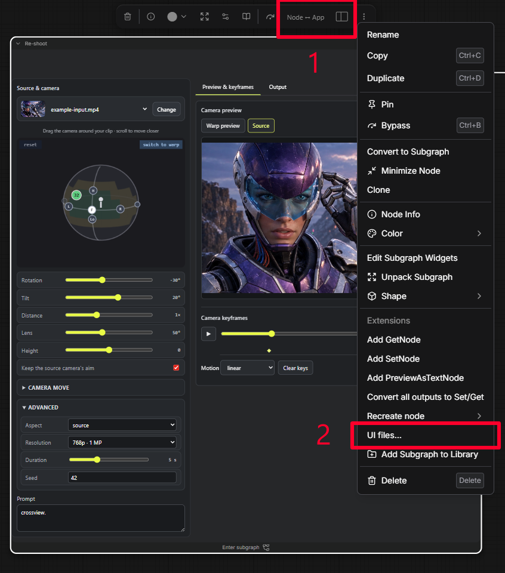

# ComfyUI-App-View

`ComfyUI-App-View` is a generic extension for custom interfaces on native
ComfyUI subgraphs. Select a subgraph and use **Node ↔ App** to switch between
its normal node controls and an installed custom UI. Both edit the same workflow.
The adjacent panel icon expands the App's right-hand workspace. Essential
controls stay on the left; section buttons select previews, editing or results.
Resizing keeps the selected layout and stops before its panels no longer fit.

Workflow-specific UIs are separate folders. They are not part of the extension.

<table>
  <tr>
    <td align="center" width="66%">
       
      <strong>Subgraph with custom UI</strong>
    </td>
    <td align="center" width="34%">
       
      <strong>1 — Controls · 2 — Share UI</strong>
    </td>
  </tr>
</table>

## Install

Copy `custom_nodes/ComfyUI-App-View` into your ComfyUI `custom_nodes` folder and
restart ComfyUI.

For an existing installation, rename its extension folder to `ComfyUI-App-View`
before copying the update.

## Create your own UI

Give a coding agent your workflow and the
[comfy-app-view-authoring skill](.agents/skills/comfy-app-view-authoring/SKILL.md).
It returns the prepared workflow JSON and one named UI folder for each custom
subgraph interface.

The same installed UI can be reused by compatible subgraphs in other workflows.

## Share UI

Right-click a custom-UI subgraph and select **UI files…**. Send the saved
workflow JSON and the complete UI folders listed there.

## Open UI

Copy each received UI folder into
`ComfyUI/custom_nodes/ComfyUI-App-View/web/renderers/`, restart ComfyUI, and open
the received JSON. Select its subgraph and choose **App** in **Node ↔ App**.

Importing a workflow JSON does not install its UI folder.

## Optional example

Installing `ComfyUI-App-View` installs no workflow-specific UI. The examples are
kept separately from the extension:

- [Re-shoot](examples/reshoot/README.md)
